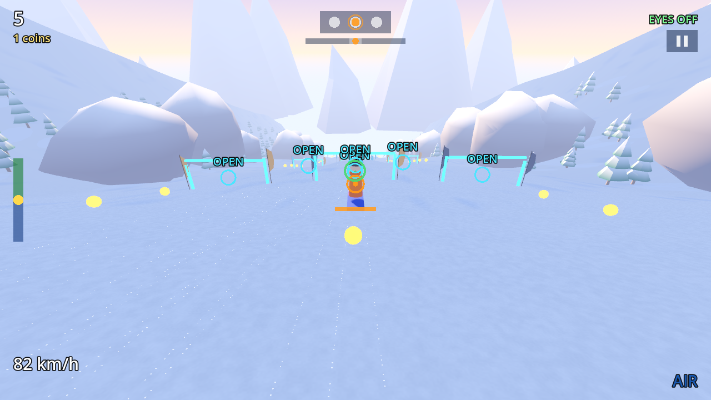
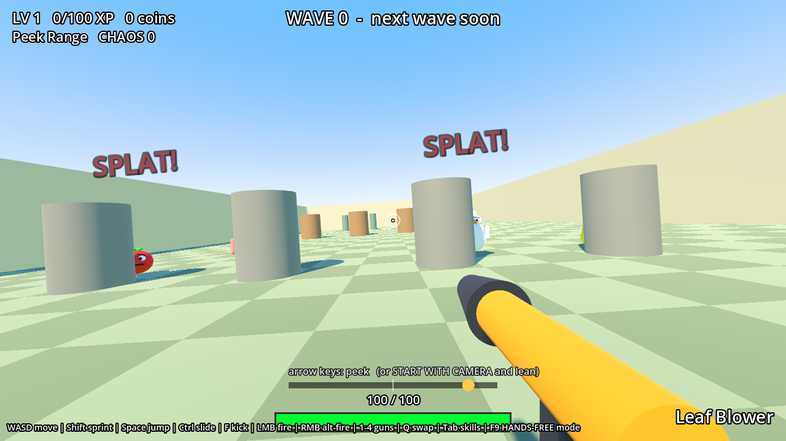
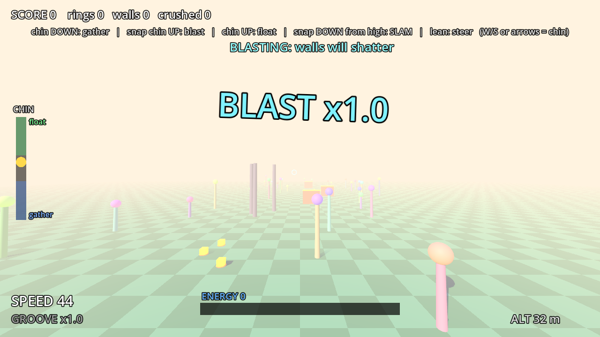

<div align="center">

# 👁 gaze-lab

### Games you steer with your eyes.
**Godot 4 · 3D · webcam eye-tracking · runs in the browser · nothing leaves your machine**

[**▶ Play Carve (test build)**](https://joshuaopolko.com/gaze-lab/godot-dev/?level=carve) ·
[Downhill](https://joshuaopolko.com/gaze-lab/godot/?level=downhill) ·
[Peek & Blast](https://joshuaopolko.com/gaze-lab/godot/?level=peek) ·
[Nod Flight](https://joshuaopolko.com/gaze-lab/godot/?level=flight) ·
[EyeLab](https://joshuaopolko.com/gaze-lab/eyelab/)



</div>

---

## What is this?

A playground for **new kinds of play that only make sense when the computer knows where you're looking**.
No headset, no tracker bar, no calibration dots: just an ordinary 1080p webcam and a browser tab.

Your eyes are not a mouse replacement here. They are the *decision* channel:

- **Look at a gate, and the board commits to it.** The game reads your gaze, latches the opening you chose
  (after about 0.2 s of dwell), and carves through it. The raw look only trims the line.
- **Far-away openings all look alike until you look at them.** Looking buys information early.
- **Trees and rocks dodge themselves.** The skill is *tracking*: picking the right gate, in time, at up to 50 m/s.
  Pick the wrong one and you go through it, recover, and get the next.

## The experiences

| | Mode | How you play |
|---|---|---|
|  | **Carve** / **Downhill** (`?level=carve`, `?level=downhill`) | A snow run down a procedural mountain. Eyes choose the gate; the board does the carving; speed builds from 34 to 51 m/s. |
|  | **Peek & Blast** (`?level=peek`) | Lean your head to peek out from cover; look to aim; tomato-throwing baddies hide behind round cover. |
|  | **Nod Flight** (`?level=flight`) | Chin down gathers energy, snap your chin up to blast through walls, lean to steer. |
| | **Eye arena** (`?level=eyes`) | The original hands-free demo: gaze locks on targets, a blink fires, a wink swaps guns. |

No camera? Every mode falls back to mouse and touch, with the pointer standing in for your eyes.

## How the tracking works

Everything runs **on-device in the browser**. The video never leaves the page.

```
 webcam ──► MediaPipe FaceLandmarker (Web Workers)
              │
              ├─► head pose, lean (cm), blink / wink, nod velocity
              └─► eye patches ──► iris limbus fit (sub-pixel iris position)
                                     │
                          per-eye fusion (EyeFuse: weights each eye by how trustworthy it is right now)
                                     │
                       iris-in-eye, scaled to *your* glance range, self-recentring
                                     ▼
                          gaze reticle  ──►  game
```

- **Automatic calibration.** No staring at dots. The glance range is learned from how you actually look, and a stale
  centre re-centres itself.
- **Per-eye weighting** for glasses, squints and head roll. Iris position is measured along the eye-corner axis, so a tilted head
  doesn't leak into the horizontal signal.
- **A built-in TRACE test.** Follow a dot, and the game measures your tracker's latency, gain and fit, then reports
  numbers instead of vibes.
- **Honest numbers.** On a laptop with an onboard GPU the tracker runs at roughly 10 to 13 frames a second with about 200 ms of
  latency. The control law is built around that: eyes pick the target, the game does the precise steering.

## Repo layout

```
gaze-lab/
├── godot/     Godot 4.7 project (web export, gl_compatibility): the games, the tracker bridge, headless tests
├── eyelab/    EyeLab: a plain-web lab for tracking and calibration experiments (no build step)
└── web/       (soon) three.js and other non-Godot experiments
```

## Run it

**Play in the browser:** use the links above, allow the camera, and pick *START WITH CAMERA*.
Use Chrome on a desktop or laptop with a webcam. Wear the glasses you actually wear.

**Run the Godot project locally**

1. Install [Godot 4.7](https://godotengine.org/) and open the `godot/` folder.
2. Press **F5** (main scene `scenes/MainLevel.tscn`). Mouse and keyboard work without a camera.
3. Run the headless tests, for example:
   ```bash
   godot --headless --path godot res://tests/carve_test.tscn
   godot --headless --path godot res://tests/trace_test.tscn
   ```
4. Web export: `godot --headless --path godot --export-release Web build/web/index.html`
   (needs the web export templates). Serve the output over `localhost` or HTTPS, since camera access requires it.

**EyeLab:** open `eyelab/run.bat` on Windows, or serve the `eyelab/` folder on localhost.

## Status

Experimental and in active development. Steering and tracking are tuned against a simulator and one webcam setup;
expect rough edges on other hardware. The long-term aim is stranger and more beautiful than games:
gaze-centred fractals, point clouds and trance visuals that respond to where you look.

## Licence

All rights reserved. The code is public to read and learn from, but you may not copy, redistribute or reuse it without permission.
